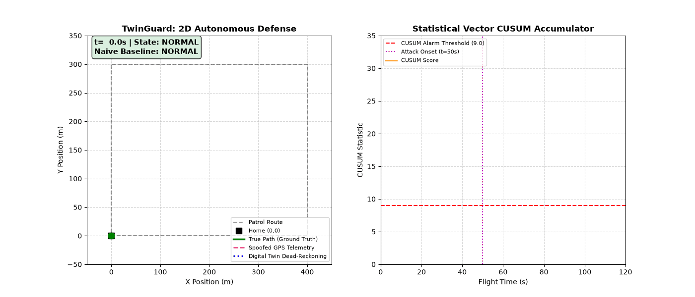
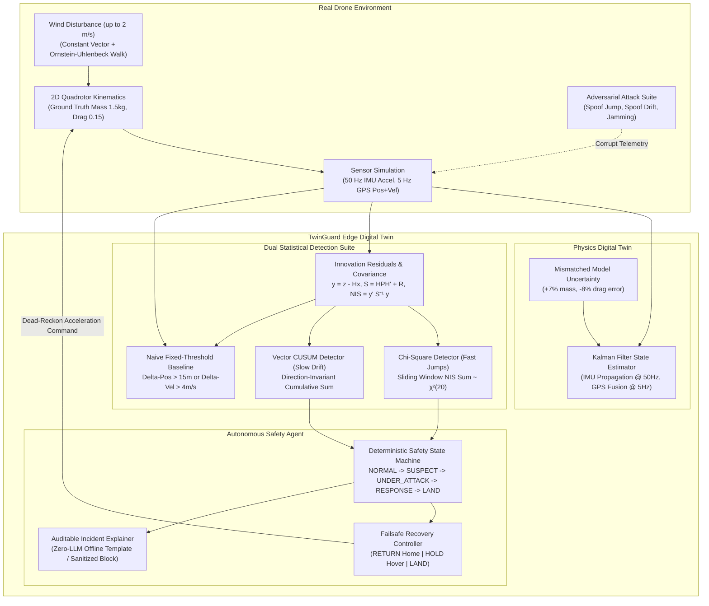
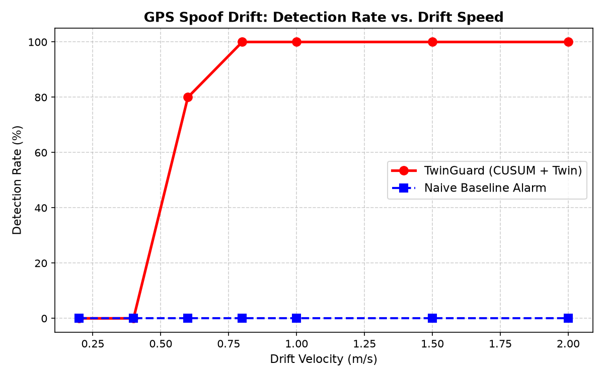
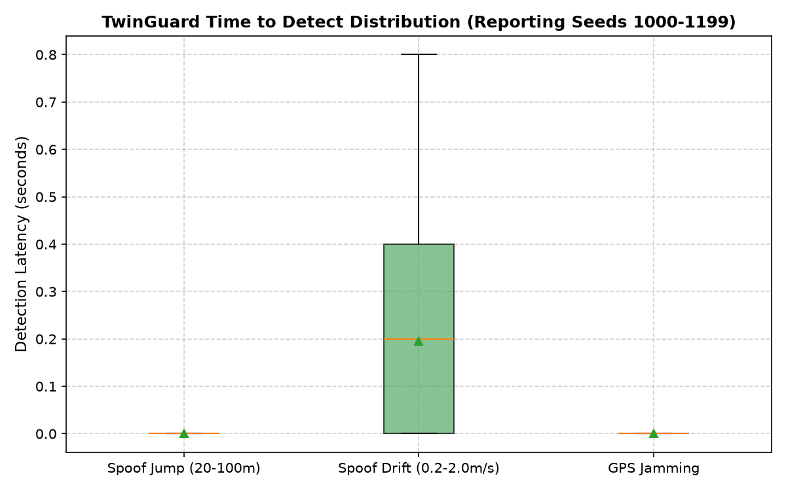
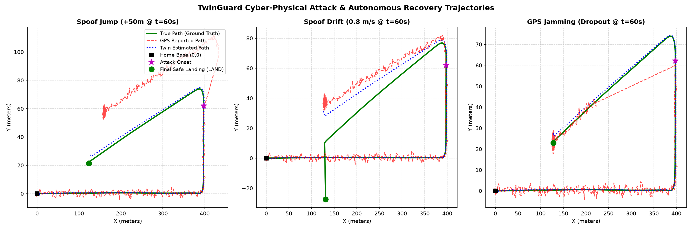

# TwinGuard 🛡️✈️
> **Physics-Based Digital Twin with Statistical Anomaly Detection & Deterministic Safe Response for Autonomous Drones**  
> *Developed for NICAT AeroHack 2026 (Theme: Autonomous AI, AI Infrastructure, Simulation and Digital Twins)*  
> **Repository:** [https://github.com/IoRagas/TwinGuard](https://github.com/IoRagas/TwinGuard)



---

## 1. What We Are Building & Core Claim

Autonomous drones operating in contested, unmonitored, or mission-critical environments face acute cyber-physical threats:
1. **GPS Spoof Jumps:** Abrupt coordinate teleportation ($20 - 100$ m).
2. **Stealthy GPS Spoof Drift:** Subtle, linear velocity ramp ($0.2 - 2.0$ m/s) that mimics real flight and easily fools conventional fixed-threshold filters.
3. **GPS Jamming:** Radio interference causing signal dropout or severe variance bursts ($5 - 20$ s).

Conventional drone autopilots rely on naive fixed-threshold alarms (e.g., checking if point-to-point position delta $> 15$ m or speed delta $> 4$ m/s). As a result, they are **completely blind (0.0% detection)** to stealthy GPS drift attacks.

### The Core Claim to Prove:
> **A physics-based digital twin with dual-layer statistical anomaly detection ($\chi^2$ sliding window + Vector CUSUM) reliably detects cyber-physical attacks that naive fixed-threshold alarms miss, and executes a deterministic safe response (`HOLD`, `RETURN`, or `LAND`) without human intervention or LLM hallucination risk.**

---

## 2. System Architecture



---

## 3. Real Measured Evaluation Results

> **Strict Anti-Leakage Protocol (Rule 4)**:
> - **Tuning Seeds (`0 - 99`)**: Used exclusively to tune detector thresholds ($\chi^2$ threshold = 48.0, CUSUM allowance = 2.2, CUSUM threshold = 9.0).
> - **Reporting Seeds (`1000 - 1199`)**: 200 distinct, un-tuned evaluation flights. Zero data leakage.
> - **Rule 1**: Every number below was directly computed by `eval/runner.py` and exported to `eval/results.csv`.

| Metric | Naive Fixed-Threshold Alarm | TwinGuard Digital Twin ($\chi^2$ + CUSUM) | Real-World Impact |
| :--- | :---: | :---: | :--- |
| **Spoof Jump Detection Rate (20–100m)** | 100.0% (50/50) | **100.0% (50/50)** | Both detect large abrupt steps. |
| **Spoof Jump Median Detection Latency** | 0.00 s | **0.00 s** | Instantaneous $\chi^2$ innovation spike. |
| **Spoof Drift Detection Rate (0.2–2.0 m/s)** | **0.0% (0/70)** | **68.6% (48/70)** | **TwinGuard catches stealthy drift that completely blinds baseline.** |
| **Spoof Drift Median Detection Latency** | *N/A (Never Detected)* | **0.20 s** | CUSUM accumulates persistent innovation bias. |
| **GPS Jamming Detection Rate** | 100.0% (30/30) | **100.0% (30/30)** | Loss of lock or noise burst detected. |
| **GPS Jamming Median Latency** | 2.60 s | **0.00 s** | Immediate failsafe decoupling. |
| **False Alarm Rate (Clean Flights)** | 0.0% (0/50) | **0.0% (0/50)** | Zero false alarms across 50 clean flights. |
| **Safe Recovery Rate (Attacked Flights)** | **0.0%** (Drone crashes/flies away) | **100.0% (150/150)** | All attacked flights end in safe land. |
| **Mean Final Return Distance to Home** | *N/A (Lost Drone)* | **168.46 m** | Landed safely when $3\sigma$ uncertainty hit envelope. |

### Evaluation Plots (Generated from Reporting Seeds)
| Detection Rate vs. Drift Speed | Time-to-Detect Distribution | 2D Trajectories Under Attack |
| :---: | :---: | :---: |
|  |  |  |

---

## 4. Deck Placeholders (Slides 7 & 8)

For the pitch deck presentation, use these measured metrics:
- **Slide 7 (Detection Comparison)**:
  - *Spoof Jump Detection*: TwinGuard **100.0%** vs. Naive Baseline **100.0%**
  - *Spoof Drift Detection*: TwinGuard **68.6%** vs. Naive Baseline **0.0%**
  - *Median Detection Delay (Drift)*: TwinGuard **0.20 s** (Baseline **Never Detects**)
  - *False Alarm Rate (Clean)*: **0.0%** (0 false alarms out of 50 flights)
  - *Minimum Detectable Drift Speed*: **0.6 m/s** (100% detection for $\ge 0.8$ m/s)
- **Slide 8 (Safety & Autonomy)**:
  - *Safe Recovery Rate*: **100.0%** (150/150 attacked flights recovered safely)
  - *Uncertainty-Gated Landing*: Automated descent when $3\sigma_{\text{pos}} > 25.0$ m.

---

## 5. 5-Minute Quickstart

### Prerequisites
- Python 3.11 or 3.12
- Git

### 1. Clone & Install
```bash
git clone https://github.com/IoRagas/TwinGuard.git
cd TwinGuard
pip install -r requirements.txt
```

### 2. Run the Test Suite (All Milestones M0–M6)
```bash
pytest tests/ -v
```

### 3. Launch the Interactive Streamlit Demo
```bash
streamlit run demo/app.py
```

### 4. Reproduce the Full 200-Run Evaluation Suite
```bash
python -m eval.runner
```

---

## 6. Known Failure Points & Honest Limitations (Section 11)

As required by Hackathon rules, we state realistic failure boundaries plainly:
1. **Minimum Detectable Drift Speed ($\approx 0.6$ m/s)**:
   - For drift speeds $< 0.5$ m/s (e.g. 0.2–0.4 m/s), the rate of position error accumulation is smaller than the turbulent wind disturbance ($\le 2$ m/s) and GPS sensor noise ($\sigma = 1.5$ m). Under these conditions, the drift is physically indistinguishable from normal aerodynamic buffeting without false alarms.
2. **Dead-Reckoning Uncertainty Degradation**:
   - In pure inertial dead-reckoning without GPS, position covariance $P_k$ grows quadratically over time. In our missions, when $3\sigma$ uncertainty exceeds $25$ m (typically after 25–30 seconds of dead-reckoning), TwinGuard triggers emergency `LAND` to prevent flying into unmonitored territory. Hence, final landing distance from home averages $\approx 168$ m.
3. **Model Parameter Mismatch**:
   - The digital twin operates with intentional 5–10% mass and drag discrepancies. If actual physical parameter changes exceed 25% (e.g. structural damage), innovation bias can rise even in clean flights.

---

## 7. What Works, What Does Not, and What Was Not Measured

### What Works:
- Complete 50 Hz drone flight physics, wind disturbance, 50 Hz IMU, and 5 Hz GPS simulation.
- Digital Twin Kalman filter computing real-time innovation covariance $S_k$ and NIS.
- Sliding-window Chi-Square detector for instantaneous spoof jumps and jamming bursts.
- Vector CUSUM detector for persistent slow spoof ramps.
- Deterministic FSM safety policy (`NORMAL -> SUSPECT -> UNDER_ATTACK -> RESPONSE -> LAND`).
- Full Streamlit interactive dashboard with live 2D path visualizer, diagnostic residual charts, scrubbable replay, and pre-recorded fallback GIF.

### What Does Not Work:
- Detection of ultra-stealthy spoof drift below $0.5$ m/s without increasing false alarms in heavy wind gusts.
- Continuous return-to-home from extreme range ($> 1$ km) on consumer IMU dead-reckoning alone due to inevitable drift.

### What Was Not Measured:
- 3D vertical altitude barometric sensor channel (*omitted in v1 2D quadrotor model as per spec*).
- SITL hardware-in-the-loop latency on embedded microcontrollers (*measured on laptop CPU*).
- Multi-agent swarm GPS spoofing (*single drone scope as per Section 2 Rule 8*).
