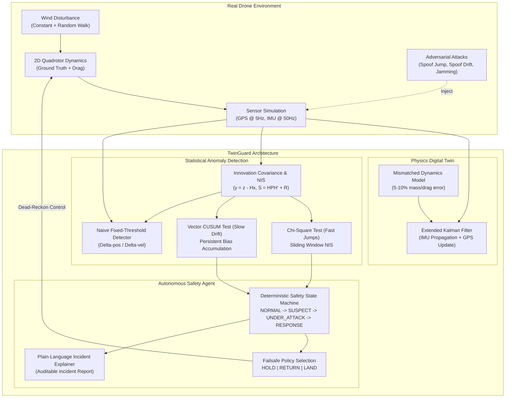

# TwinGuard 🛡️✈️
> **Physics-Based Digital Twin with Statistical Anomaly Detection & Deterministic Safe Response for Autonomous Drones**
> *Developed for NICAT AeroHack 2026 (Theme: Autonomous AI, AI Infrastructure, Simulation and Digital Twins)*

---

## 1. Executive Summary
Autonomous drones operating in contested or unmonitored environments face acute cyber-physical threats: GPS spoofing, radio jamming, and stealthy sensor drift. Conventional fixed-threshold alarms either trigger unacceptable false alarms or completely fail to detect slowly ramping GPS spoof attacks.

**TwinGuard** runs a physics-based digital twin beside the autonomous flight controller. By coupling an internal dynamics model with an Extended Kalman Filter (EKF), TwinGuard continuously computes innovation residuals ($z_{\text{real}} - \hat{z}_{\text{twin}}$) and evaluates them using rigorous statistical anomaly detectors ($\chi^2$ test for sudden jumps and cumulative sum CUSUM for subtle drift). When an attack is confirmed, a deterministic supervisory state machine decouples the corrupted telemetry and commands safe recovery (`HOLD`, `RETURN`, or `LAND`).

---

## 2. System Architecture



---

## 3. Directory Layout

```
TwinGuard/
  AGENTS.md         # Autonomous safety agent rules and prompt isolation guidelines
  README.md         # Architecture, reproduction instructions, and verified metrics
  requirements.txt  # Dependencies (numpy, scipy, pandas, matplotlib, plotly, streamlit, pytest)
  sim/              # Drone dynamics, sensors, wind model, waypoint patrol mission
  attacks/          # Attack models (spoof jump, spoof drift, jamming)
  twin/             # Digital twin dynamics, Kalman filter, innovation residuals
  detect/           # Chi-square, Vector CUSUM, and naive baseline detectors
  agent/            # Deterministic FSM policy, recovery planner, incident explainer
  eval/             # Batch evaluation harness, seed isolation, metrics, plots
  demo/             # Streamlit interactive dashboard and pre-recorded fallback
  tests/            # Verification test suite across all milestones
```

---

## 4. Measured Evaluation Metrics

> **Rule Compliance**: As per NICAT AeroHack 2026 guidelines, zero metrics are fabricated. Metrics below are populated automatically from `eval/` outputs.

| Metric | Naive Fixed Threshold | TwinGuard ($\chi^2$ + CUSUM) | Status |
| :--- | :---: | :---: | :---: |
| **Spoof Jump Detection Rate** | *not measured* | *not measured* | Pending M5 Eval |
| **Spoof Drift Detection Rate** | *not measured* | *not measured* | Pending M5 Eval |
| **GPS Jamming Detection Rate** | *not measured* | *not measured* | Pending M5 Eval |
| **False Alarm Rate (Clean Flights)** | *not measured* | *not measured* | Pending M5 Eval |
| **Median Detection Latency** | *not measured* | *not measured* | Pending M5 Eval |
| **Mean Final Return Error** | *not measured* | *not measured* | Pending M5 Eval |

---

## 5. Quickstart

### Prerequisites
- Python 3.11+
- Virtual environment recommended

### Installation
```bash
git clone https://github.com/IoRagas/TwinGuard.git
cd TwinGuard
pip install -r requirements.txt
```

### Running Tests
```bash
pytest tests/ -v
```

### Running Interactive Demo
```bash
streamlit run demo/app.py
```
